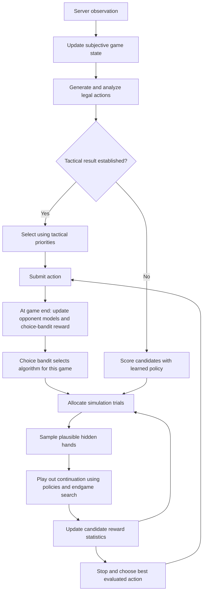

# Ninja: a source-based guide to the Daifugō AI

## High-level overview

Ninja is a C++ program that plays **Daifugō**, also called Daihinmin and closely related to President, using the UEC Computer Daihinmin Contest protocol. It is a competitive card-shedding game: players try to empty their hands before their opponents, and their finishing positions affect the next game's card exchange. Despite this document's location under `docs/hanabi/`, the inspected program does not play Hanabi.

Ninja builds on **FujiGokoro (藤心)**, an existing game-playing engine. Most of its strength comes from combining several techniques: fast legal-move generation, tactical searches for guaranteed finishes, learned move preferences, inference about opponents' hidden cards, and Monte Carlo simulation. Its distinctive extension is a **choice bandit**: an outer learning mechanism that chooses which algorithm will allocate simulations among candidate moves during a game.

In everyday terms, the engine asks three different questions:

1. **Can I establish a good move directly?** Check legality, forced finishes, and small endgames.
2. **If the answer is uncertain, what happens when I try each move?** Imagine plausible opponent hands and simulate how play develops.
3. **Which way of spending that simulation effort works best?** Track the results obtained by several simulation-selection algorithms across actual games.

That last question is Ninja's main architectural addition. It adapts the search procedure, rather than replacing FujiGokoro's card-game knowledge with a new model.

## 1. Identity and provenance

The archive's README still identifies the project as FujiGokoro and credits it with winning the unrestricted UECda competition in 2014, 2015, and 2016. That is a claim in the inherited README about FujiGokoro; it is not evidence that this Ninja snapshot achieved the same results.

The code makes the relationship clearer than the README:

- `src/settings.h` sets the Monte Carlo client's name to `Ninja`. Its added settings block is attributed to Satoru Tomioka.
- The main engine remains `UECda::Fuji::Client`, implemented in `src/fuji/FujiGokoro.hpp`, with inherited files attributed to Katsuki Ohto.
- Added choice-bandit code is marked in several places with comments referring to “Soniqs.” Those comments establish a modification boundary, but do not by themselves establish a complete release history.
- The reported engine version remains `20170813`, even though the archive contains later-looking file timestamps. The version string should not be treated as a reliable date for every modification.
- The included `LICENSE` contains the GNU GPL version 3 text.

The snapshot contains source, parameter files, test data, shell scripts, compiled artifacts, debug material, and a file named `core`. Existing binaries are not proof that the current source and build configuration reproduce those binaries.

## 2. The game concepts the engine needs

The configured game has five players and a 53-card deck, including a joker. Players submit single cards or legal combinations, or pass. Responding usually requires a stronger combination of the appropriate shape. Emptying a hand establishes a finishing class; later games include exchanges between higher- and lower-ranked players.

Several rules make simple “play the weakest legal card” strategies inadequate:

| Concept | Meaning in the engine | Strategic consequence |
| --- | --- | --- |
| Group | Cards of the same rank | A strong pair may be more useful intact than as two singles. |
| Sequence | A run of ranks in one suit | Playing a card can destroy a future multi-card move. |
| Revolution | A reversal of rank ordering | A hand's apparent strength can change dramatically. |
| Suit lock | A restriction on the suits of subsequent responses | A move can limit which opponents can respond. |
| Eight cut | A play involving an eight can clear the board under the implemented rules | Keeping an eight can preserve a way to regain the lead. |
| Joker / spade three | The joker has special power, with a special spade-three response | The best use of either card depends on whether the other remains available. |
| Passing and board ownership | Passing changes who remains active until the board clears | Passing can be a deliberate route to control, rather than merely an inability to play. |

These are explanatory descriptions of concepts represented in the source, not a complete standalone rules specification. The relevant implementations are in `structure/primitive/`, `generator/`, and the field-transition code.

Two recurring terms deserve particular care. **Dominance** means that a play cannot be beaten by the relevant opposing cards or players under the current conditions. **Mate** is borrowed search terminology for a provable finish or winning continuation. A move that dominates the board need not, by itself, finish the hand.

## 3. The architecture

The project separates communication, game state, decision-making, and supporting tools, although much of the implementation lives in large headers rather than separately compiled modules.

| Area | Main files | Responsibility |
| --- | --- | --- |
| Client and connection | `src/client.cc`, `src/connection.c`, `src/connection.h` | Connect to the server, receive observations, submit actions, and run the game lifecycle. |
| Rules and representation | `src/UECda.h`, `src/structure/primitive/`, `src/structure/hand.hpp` | Represent cards, moves, boards, ranks, and derived hand properties. |
| State and records | `src/structure/field/`, `src/structure/log/` | Maintain client/server state and game histories. |
| Action generation | `src/generator/moveGenerator.hpp`, `changeGenerator.hpp` | Enumerate plays and card exchanges. |
| Main AI | `src/fuji/FujiGokoro.hpp` | Combine tactical analysis, policy scores, and simulation into decisions. |
| Search statistics and choice bandit | `src/fuji/fujiStructure.hpp` | Store candidate statistics and choose a simulation algorithm for each game. |
| Monte Carlo evaluation | `src/fuji/montecarlo/` | Allocate trials, sample worlds, simulate continuations, and collect rewards. |
| Hidden-hand inference | `src/fuji/estimation/dealer.hpp`, `galaxy.hpp` | Construct and manage plausible allocations of unseen cards. |
| Policies and opponent models | `src/fuji/policy/`, `src/fuji/model/` | Score actions and adjust predictions for individual opponents. |
| Tactical/endgame solvers | `src/fuji/logic/`, `src/fuji/search/` | Detect dominance and finishes, and solve restricted endgames. |
| Training and evaluation | `src/policy_learner.cc`, `src/test/`, `scripts/` | Learn parameters, analyze records, and exercise engine components. |
| Shared support | `CppCommon/` | Bit operations, random generators, distributions, classifiers, hashing, and utilities. |

The principal flow is:



The choice-bandit branch applies to the normal **play** search. The exchange path still calls the inherited Monte Carlo routine, an important distinction discussed below.

## 4. How a normal turn is decided

The main entry point is `Client::playSub()` in `FujiGokoro.hpp`.

### 4.1 Construct a useful search position

The client converts its current state into a `PlayouterField` using `setSubjectiveField()`. “Subjective” means that this position reflects the client's information: its own cards are known, while the allocation of unseen cards among opponents is not.

The engine also maintains an aggregate opposing hand. This is useful for conservative questions such as whether any remaining card can beat a proposed play; it does not imply knowledge of which opponent holds that card.

### 4.2 Generate and annotate candidate moves

`genMove()` enumerates ordinary legal actions. The client has quick returns for no available action or a single generated action. It can add special candidates, including a pass on an empty board and certain joker group representations. Candidate order is shuffled to avoid consistently resolving otherwise equivalent choices according to generation order.

Each candidate receives additional information: whether it changes rank order, creates a suit lock, dominates relevant responses, or advances the hand toward a small number of remaining melds. A **meld** here is a combination that can be played together. Estimating the minimum number of melds helps distinguish shedding many cards from leaving an awkward residual hand.

### 4.3 Look for tactical answers

The engine checks for multi-player finishing sequences and, when two players remain, invokes `L2Judge`. At the root, the two-player solver is constructed with a 400,000-node limit; inside playouts, the corresponding limit is 65,536.

This is a hybrid design: use direct reasoning where it can settle the question, then use simulation for unresolved positions. Search is bounded, however, so “two-player solver” should not be read as a guarantee that every possible endgame is fully solved within budget. The code distinguishes wins, losses, and unresolved search results.

When a finish has been established, the final selection applies tactical priorities, including immediate finishing, stronger finish classifications, and preferences among equivalent continuations. Some tie-breaking also considers revolution and the strongest rival's situation.

### 4.4 Apply the learned policy

Every generated candidate is scored with the play policy. A policy is a rule for preferring or sampling actions. Here it is a parameterized softmax classifier over engineered features, rather than a neural network.

The policy provides a fast estimate before expensive simulation. With `USE_POLICY_TO_ROOT` enabled, it also contributes initial evidence to each candidate's Monte Carlo statistics. The engine therefore starts with informed preferences and revises them as simulations accumulate.

### 4.5 Simulate unresolved decisions

If the tactical checks have not established a mate or give-up condition, `CBMonteCarloThread()` performs the play search. Each iteration chooses a candidate, assigns plausible hidden cards, plays out the continuation, and feeds the resulting reward back into the candidate's statistics.

The nominal play budget is:

```text
min(5000, floor(700 * number_of_generated_moves^0.8))
```

That budget is computed before the root's final candidate management. It is a simulation-count limit, not a promise of fixed wall-clock time. An additional stopping test estimates whether the expected benefit of further thinking justifies its cost.

### 4.6 Select the action to submit

`RootInfo::sort()` prioritizes unpruned candidates, then their mean Monte Carlo scores, with policy information breaking ties. Thus, the algorithm that selects **the next move to simulate** is distinct from the rule selecting **the move actually played**. An exploration bonus can make an uncertain move worth investigating without making it the final choice.

## 5. Ninja's distinctive addition: a bandit choosing bandits

### 5.1 The two levels

A bandit algorithm balances **exploitation**—spending effort on options that already look good—with **exploration**—trying uncertain options that might be better.

Ninja uses this idea at two different timescales:

| Level | Available options, or “arms” | Feedback | Decision frequency |
| --- | --- | --- | --- |
| Inner bandit | Candidate card plays at the current root | Reward from simulated continuations | Each simulation trial |
| Outer choice bandit | Different inner-bandit algorithms | Ninja's finishing-class reward in an actual game | Once per game |

For example, the outer layer might choose KL-UCB for a game. During that game, KL-UCB decides which card-play candidates receive additional simulations. At game end, the outer layer credits the KL-UCB option with the observed finishing reward.

This is algorithm selection across games. The inspected outer selector does not take the current hand or a contextual feature vector as input, so it should not be described as a contextual bandit. Its statistics accumulate within the client process; this path does not show a mechanism for saving and restoring them across runs.

### 5.2 The available inner algorithms

`settings.h` enables five choices, dispatched by `selectBanditAction()` in `monteCarlo.hpp`:

| Algorithm | How it allocates effort |
| --- | --- |
| UCB-root | Combines estimated reward with a root-oriented exploration bonus. |
| KL-UCB | Uses a Bernoulli KL-divergence calculation to construct an optimistic reward estimate. |
| UCB2 | Organizes repeated trials into epochs, with additional per-arm bookkeeping. |
| UCB1-Tuned | Adjusts exploration using a variance-related term and a cap. |
| UCB-V | Uses a variance-related bonus plus an additional exploration term. |

A voting selector also exists, but is not among the five enabled choices in the supplied default configuration.

There are important implementation details behind those names. UCB-root's index, once its initial-trial condition is satisfied, is:

```text
mean_i + 0.7 * sqrt(sqrt(total_distribution_size) / distribution_size_i)
```

The distribution sizes include prior evidence, so they are not simply the number of completed simulations. KL-UCB uses a bounded Newton iteration, rather than an exact symbolic solution. Several selectors explicitly balance distribution sizes when there are exactly two candidates, instead of using their usual multi-candidate index.

The variance accessors also deserve attention: `mean_var()` returns the variance of the stored beta distribution, and `var()` multiplies that quantity by its size. These are the implementation's uncertainty measures. One should not assume that every formula is an unchanged textbook implementation using empirical reward variance.

### 5.3 The outer lifecycle and reward

`CBRootInfo` and `CBRootAction` hold the outer layer's state. The client calls:

1. `initCBGame()` once before the game loop, to register enabled algorithms and initialize statistics.
2. `setCBGame()` during each game's setup, to choose the inner algorithm.
3. `closeCBGame()` after that game finishes, to record its result.

Despite names such as `allMatches` and `feedMatchResult()`, the feedback is supplied after an individual game in the server session.

For five players, `REWARD(class)` gives 5, 4, 3, 2, or 1 for the five finishing classes. The outer layer converts this into:

```text
normalized_reward = (reward - 1) / 4
```

First place therefore contributes 1, last place 0, and the intermediate places contribute 0.75, 0.5, and 0.25. Each algorithm starts with `Beta(1, 1)` evidence; a result adds `(normalized_reward, 1 - normalized_reward)` to its distribution. Fractional results are used as fractional evidence, rather than treating every outcome as a binary win or loss.

The intended default outer algorithm is UCB-V, selected by `CB_UCB_V`. This means “use UCB-V to choose among five inner algorithms,” not “always use UCB-V for card-play search.” However, the initialization issue in section 12 materially qualifies that intended behavior.

### 5.4 What the outer feedback can and cannot tell us

A finishing result depends on the deal, exchanges, opponents, tactical shortcuts, policies, and simulation allocation. The outer bandit attributes that entire result to its selected algorithm. Its feedback is therefore noisy and does not isolate the algorithm's causal contribution.

It also receives a result from games where tactical checks may have avoided much of the Monte Carlo search. Establishing that adaptation improves strength would require controlled comparisons, repeated seeds, and enough games to separate signal from deal variance. Source code alone does not establish that improvement.

## 6. How Monte Carlo evaluation handles hidden cards

### 6.1 A simulation needs a complete possible world

Ninja cannot simulate legal continuations without assigning cards to opponents. A **world** is one possible complete allocation consistent with the information used by the estimator. `RandomDealer` constructs these allocations, while the `Galaxy` machinery stores and manages sampled worlds.

The estimator offers four modes: random dealing, dealing with subjective information, biased dealing, and rejection-based dealing. The default is `DealType::REJECTION`.

The rejection-based path accounts for exchange constraints and uses play history to judge plausible holdings. In its multi-candidate branch, it generates several allocations, computes their play likelihoods, and selects among them with a softmax selector at temperature 0.3. Although a nearby comment describes selecting the maximum-likelihood candidate, the active code samples from these likelihood scores.

This is approximate inference. It is more informed than blindly shuffling unseen cards, but is not evidence of exact Bayesian posterior sampling. It includes limits and fallback behavior when exchange-compatible generation is difficult.

### 6.2 Reusing worlds makes comparisons more consistent

Each simulation thread maintains its own world pool and per-candidate trial counts. The scheduler attempts to evaluate different moves against corresponding stored worlds before repeatedly sampling from the pool. This helps reduce accidental differences caused by evaluating one move only against easy deals and another only against difficult ones.

The main play path clears its pools at the start of a new Monte Carlo decision. World-management hooks also react to observed plays; the presence of these hooks should not be mistaken for a permanently preserved belief tree across every decision.

### 6.3 Continuations use informed play

`Playouter` applies the candidate root move, then simulates subsequent turns. The continuation policy uses learned action scores, optional opponent adjustments, and tactical/endgame checks. These are not uniformly random rollouts.

The default simulation selector is polynomially biased, with a play temperature of 1.1, amplification coefficient 0.22, and exponent 2. Randomness provides variation while the policy concentrates simulations on plausible actions.

Conceptually, this is root-level Monte Carlo action evaluation over sampled complete states, supplemented by tactical searches. It is not a conventional implementation that grows a persistent UCT tree throughout the entire game.

## 7. Policies, tactical knowledge, and rewards

### 7.1 What the learned policies represent

The play policy's features cover both the submitted move and the hand it leaves behind. Examples include rank/group/sequence structure, joker and spade-three interactions, meld count, number of cards played, suit-lock effects, revolution preferences, passing context, and the cost of breaking useful groups.

The exchange policy evaluates the residual hand and exchange-specific patterns. Features include diamond-three retention, the joker/spade-three relationship, high and low ranks, and whether the returned cards form useful combinations for the recipient.

The parameter files are present in this snapshot:

- `param/play_policy_param.dat`
- `param/change_policy_param.dat`

The accompanying comment files expose human-readable feature groups and weights. Separate estimation-policy files are optional: initialization falls back to the base policy files if the estimation versions are absent. This contradicts the inherited README's statement that parameters have not yet been uploaded; the local file inventory is the relevant evidence for this archive.

### 7.2 Policy priors in the root search

Before simulation, candidate policy scores are rescaled between the minimum and maximum score. The root adds beta-distribution evidence with a strength determined by:

```text
prior_strength = 4 * (candidate_count - 1)^0.6
```

The inherited `Beta(1, 1)` starting evidence is also present. This gives policy preferences influence early in search without requiring that every high-scoring move remain preferred after simulated outcomes arrive.

### 7.3 Simulation reward is not the same as outer-bandit reward

The outer choice bandit learns from normalized finishing class. The inner engine has a richer reward setup: `value.hpp` contains class-transition and seat-related tables, and `initGame()` computes rewards using the estimated distance to class and seat resets.

The motivation is that finishing well now can improve future card exchanges. A search objective can therefore value a finish partly through its future consequences, rather than only its immediate placement. The configured reward-table horizon is 32 games; this does not mean that each rollout explicitly plays 32 additional games.

Keeping these reward systems separate is essential when interpreting results. The outer layer is not simply receiving a copy of the inner search's expected reward.

## 8. Card exchange is a separate decision path

`Client::change()` chooses one or two cards to return during the exchange phase. It begins with heuristic pruning, generates legal exchange sets, checks certain immediate tactical opportunities, evaluates the exchange policy, and simulates candidate results when needed.

Its nominal budget is:

```text
min(10000, floor(700 * number_of_exchange_candidates^0.8))
```

With the supplied settings, exchange search uses four threads and play search uses eight. Crucially, exchange calls `MonteCarloThread()`, while normal play calls `CBMonteCarloThread()`. The outer choice bandit therefore does not control the exchange search in the inspected call path.

An intuitive example is a hand containing a valuable pair plus weak singles. Returning the numerically weakest cards may be sensible, but returning a card that breaks the pair can change the number of turns needed to finish. The exchange policy and simulations evaluate this structural effect rather than considering rank alone.

## 9. Opponent modeling and learning

There are three distinct adaptation mechanisms in the repository:

| Mechanism | What changes | Where its evidence comes from |
| --- | --- | --- |
| Offline policy learning | Feature weights for play and exchange | Recorded games processed by the learner |
| Opponent modeling | Per-player behavioral adjustments | Analysis of completed games in the current session |
| Choice-bandit learning | Preference for a simulation-selection algorithm | Ninja's actual finishing result after each game |

`policy_learner.cc` uses the softmax classifier learners and `learning/policyGradient.hpp` to process game logs. It includes feature analysis, iterations, learning-rate settings, regularization settings, and evaluation paths. The name “policy gradient” should not obscure that this tool includes learning action preferences from recorded play; it is not evidence of a deep reinforcement-learning system.

The build also exposes a `policy_rl_client` variant with `RL_POLICY`, and source branches write reinforcement-learning policy output. Those branches are separate from the default Monte Carlo client and are not evidence that ordinary Ninja continuously retrains its base policy weights during play.

Opponent modeling is enabled by `MODELING_PLAY`. `analyzePlayerModel()` runs after a completed game, so newly fitted player adjustments are not continuously refitted after every move within that same game. Current-game observations can still influence hidden-hand estimation. Timing-analysis code also exists, but timing modeling and timing-based estimation are not enabled by the corresponding default compile-time switches.

## 10. Efficient representation and parallel execution

Cards are represented by a 64-bit integer (`Cards = uint64_t`). Bit operations make set membership, intersection, removal, and many rank-pattern calculations cheap. The extra bit positions and specialized encodings support operations beyond a plain 53-element boolean array.

`Hand` caches derived information: card count, joker presence, rank multiplicities, sequence patterns, dominance-related summaries for both rank orders, and a hash. Search can reuse these summaries instead of recomputing everything from the card set at each node. The cost is that state-update routines must keep the cached forms consistent.

`ThreadTools` gives simulation threads their own random generator, scratch buffers, and world pool. `SharedData` holds shared policies, models, logs, and reward information. Root statistics are shared across workers, and `feedSimulationResult()` performs locking around updates.

The default configuration is eight play threads and four exchange threads. Sharing statistical state means that reproducibility is more complicated than setting a random seed: worker scheduling can affect which trial observes which statistics. The source's locking does not, on its own, establish that every concurrent read and write has been formally audited.

The default also enables a transposition table for two-player search. This caches previously encountered endgame positions, avoiding repeated work. General multi-player complete-information search code exists, but the corresponding leaf-search option is disabled in the supplied settings.

## 11. Build, configuration, and supporting tools

### 11.1 Build assumptions

The Makefile uses `g++`, C++14, SSE4.2, pthreads, and a Unix-like command environment. It disables exceptions and RTTI. The supplied linker flags include `-lsocket -lnsl`, explicitly labeled for Solaris.

The README's `make release -j4` instructions are stale relative to this Makefile: the exposed configurations are `default`, `debug`, and `teacher`, with no `release` target. The default outputs binaries into the project root; debug and teacher builds use their respective `out/` directories.

There are additional build obstacles:

- The aggregate default/debug recipe requests `random_client`, but its build rule is commented out.
- `client.cc` invokes the Ninja-specific choice-bandit lifecycle methods unconditionally. The human and random AI classes do not contain corresponding methods in the inspected source, making those variants suspect without integration changes.
- The shell scripts still reference `out/release/`, so their assumptions do not match the supplied Makefile.

For a Unix-like port, a focused starting command would be:

```sh
make TARGET=default preparation client server LIBRARIES="-m64 -lpthread"
```

This deliberately targets the main client and server, and substitutes common Linux-oriented libraries for the Solaris flags. It is an untested starting point, not a verified build recipe or a native Windows command. The historical README and prebuilt artifacts should not substitute for compiling and testing the desired target on the actual host.

### 11.2 Runtime paths and options

The client reads `Blauweregen_config.txt` from its working directory. The supplied file specifies:

```text
./param/
./param_out/
./record/
```

These are the parameter input directory, parameter output directory, and log directory. Paths are used by concatenating filenames, so retaining the trailing separator matters. Output directories must be suitable for whatever logging or learning mode is enabled.

Connection options include `-h` for server address, `-p` for port, and `-n` for player name. The default server address is `127.0.0.1`. Engine options include `-i` and `-o` for parameter directories and `-s` for the random seed.

Many experimental settings, including `-th`, modeling toggles, tactical-search toggles, temperatures, and dealing mode, are parsed only when `MATCH` is not defined. The default Makefile build defines `MATCH`, so those runtime switches should not be assumed to override its compiled settings. Any experimental thread count must also fit the compiled thread-storage capacity.

After a successful compatible build, the intended topology is one server and five client processes. The README documents server options for game count (`-g`), records (`-l`), and console broadcasting (`-bc`). No server or client was launched for this analysis.

### 11.3 Tests and analysis programs

The repository includes component tests for card operations, move generation, dominance, mate detection, two-player search, MaxN search, policies, and modeling. It also contains a record analyzer, rating calculator, estimator learner, value generator, and additional simulation/estimation test sources. Not every source has a corresponding active Makefile target.

`testdata/braux5.dat` supplies a bundled game-record dataset. Test executables and historical debug files are useful starting material, but they are not a current pass/fail report. Before performance research, the relevant correctness tests and a short end-to-end match should be run against newly built binaries.

## 12. Important limitations and apparent defects

### 12.1 The default outer UCB-V selector appears incorrectly initialized

This is the most consequential source-level finding for Ninja's defining feature.

`CBRootAction::clear()` initializes each algorithm's `matches` count to zero. `CBRootInfo` initializes `allMatches` to zero. But `cb_UCB_V()` gives an arm special initialization treatment when:

```cpp
child[i].matches == 1
```

For a never-tried arm, that condition is false. The ordinary formula then evaluates `log(allMatches)` and divides by `child[i].matches`. On the first selection, those inputs are `log(0)` and division by zero. Other outer selectors explicitly test for zero trials.

This can produce non-finite selection scores and undermine exploration of never-tried algorithms. The selector initializes its fallback index to zero, making unintended repeated selection of the first arm a plausible consequence. Exact runtime behavior has not been reproduced here and can be affected by floating-point handling and the optimized build flags.

Accordingly, the snapshot demonstrates an intended adaptive choice-bandit design, but should not be described as a verified functioning implementation of that adaptation. The initialization condition and finite-score handling need investigation before interpreting default-run results.

### 12.2 Tactical certainty is bounded

The two-player search has finite node limits, and the root logic contains comments acknowledging unresolved outcomes. Reports of “mate” and “give up” should be interpreted in the context of the particular solver and its result handling. They are not evidence of unrestricted exhaustive solution of the whole game.

### 12.3 Sampling quality depends on model quality

If the hidden-hand estimator favors the wrong deals, or the rollout policy mispredicts an opponent, more simulations can make the engine more confident in a biased estimate. Sampling multiple worlds reduces one source of uncertainty; it does not eliminate modeling error or the limitations of reasoning within fully assigned hypothetical hands.

### 12.4 Historical configuration drift affects reproducibility

The README, scripts, Makefile, program names, and optional variants are not fully synchronized. Supplied parameters exist despite the README saying otherwise, and release paths appear without a matching build target. Reproducing a reported experiment requires recording the actual source, macro settings, parameter files, compiler flags, seeds, and executable used.

### 12.5 Performance claims require experiments

The snapshot does not establish that Ninja beats FujiGokoro, that the choice bandit beats the best fixed selector, or that any one algorithm is consistently strongest. A meaningful comparison would first address correctness issues, then compare fixed selectors and the adaptive selector with controlled deals, opponents, and computation budgets. Equal simulation counts and equal elapsed time are different comparisons because selection algorithms have different overheads.

## 13. What this project contributes to President research

Ninja is particularly useful as an example of how multiple kinds of reasoning can cooperate in a hidden-information shedding game. Bit-level state representation makes broad simulation affordable; tactical logic settles some decisions cheaply; learned policies guide unresolved continuations; hidden-hand inference makes those continuations more plausible; and the outer bandit attempts to adapt the allocation of search effort across games.

The most transferable ideas are the separation of exact tactical checks from statistical evaluation, the explicit modeling of the hand left after a move, the distinction between exchange and play decisions, and the reuse of plausible hidden worlds when comparing actions. Its choice-bandit layer is also a concrete research hypothesis: the best simulation allocator may depend on the environment and can potentially be learned online.

Transferring those ideas to another President implementation requires checking its rules first. Ninja's features and move logic depend on sequences, revolution, suit locks, eight cuts, joker handling, and the exchange system. A policy trained for these mechanics is not automatically appropriate for a different ruleset. Transferring them to Hanabi would require substantially different state, information, action, and reward models.

## 14. Suggested source-reading order

For a reader who wants to move from this explanation into the implementation:

1. **`src/settings.h`** — establish which features and algorithms are actually enabled.
2. **`src/client.cc`** — follow the server lifecycle and the three choice-bandit hooks.
3. **`src/fuji/FujiGokoro.hpp`** — read `playSub()` and `change()` to see how decisions are assembled.
4. **`src/fuji/fujiStructure.hpp`** — inspect `RootAction`, `RootInfo`, `CBRootAction`, and `CBRootInfo`; pay particular attention to initialization and reward updates.
5. **`src/fuji/montecarlo/monteCarlo.hpp`** — compare the selectors, `MonteCarloThread()`, and `CBMonteCarloThread()`.
6. **`src/fuji/estimation/dealer.hpp` and `montecarlo/playouter.hpp`** — understand what is being sampled and how a trial obtains its reward.
7. **`src/fuji/policy/`, `logic/`, and `search/`** — examine the learned features and tactical knowledge that give the simulations their behavior.
8. **`src/policy_learner.cc`, `src/test/`, and `Makefile`** — establish how to train, validate, and reproduce the particular configuration being studied.

All source paths in this document are relative to the inspected Ninja directory. The account describes this local snapshot, including its inconsistencies; it does not assume that every similarly named upstream or competition version behaves identically.
